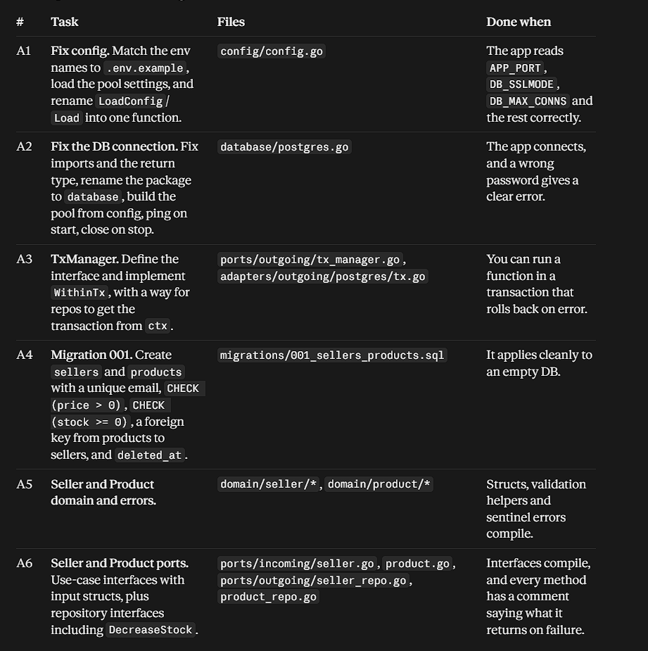
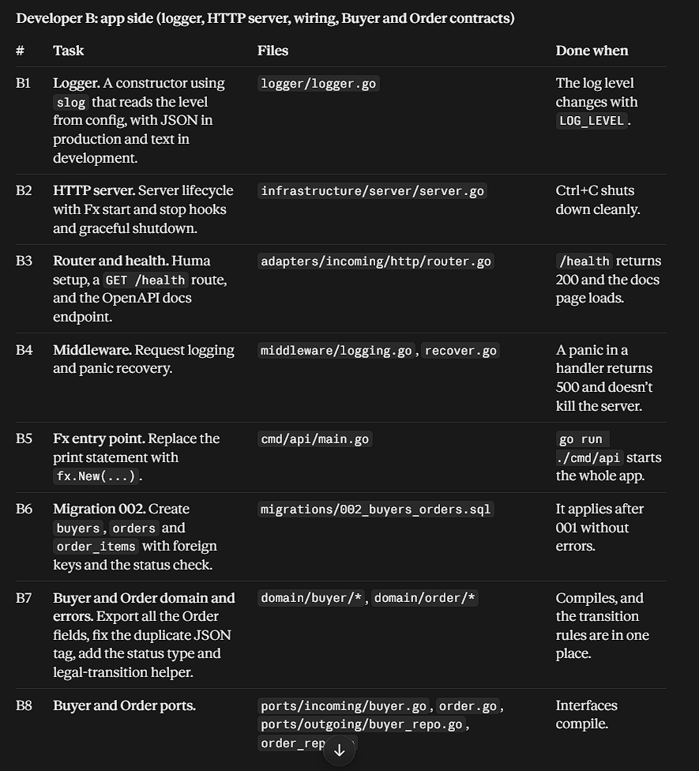

.
Go_Commerce/
├── cmd/api/main.go                      → fx.New(...).Run()
├── internal/
│   ├── domain/
│   │   ├── seller/    seller.go, errors.go
│   │   ├── product/   product.go, errors.go
│   │   ├── buyer/     buyer.go,  errors.go
│   │   └── order/     order.go, item.go, status.go, errors.go
│   │
│   ├── ports/
│   │   ├── incoming/  seller.go, product.go, buyer.go, order.go   (use-case interfaces + input structs)
│   │   └── outgoing/  seller_repo.go, product_repo.go, buyer_repo.go,
│   │                  order_repo.go, tx_manager.go
│   │
│   ├── core/
│   │   ├── seller/    service.go, service_test.go, module.go (fx)
│   │   ├── product/   service.go, service_test.go, module.go
│   │   ├── buyer/     service.go, service_test.go, module.go
│   │   └── order/     service.go, service_test.go, module.go
│   │
│   ├── adapters/
│   │   ├── incoming/http/
│   │   │   ├── router.go              (Huma setup, route registration)
│   │   │   ├── dto/                   (request/response structs, kept out of domain)
│   │   │   ├── handlers/              seller.go, product.go, buyer.go, order.go
│   │   │   └── middleware/            logging.go, recover.go
│   │   └── outgoing/postgres/
│   │       ├── tx.go                  (TxManager implementation)
│   │       └── repositories/          seller.go, product.go, buyer.go, order.go
│   │
│   └── infrastructure/
│       ├── config/    config.go
│       ├── database/  postgres.go
│       ├── logger/    logger.go
│       └── server/    server.go       (http server lifecycle via fx hooks)
│
├── migrations/  001_sellers_products.sql, 002_buyers_orders.sql
├── tests/       (integration tests)
└── docs/decisions.md

[README.md](README.md).

// interface that are we using 
| Interface | Location | What it has | Used for |
|---|---|---|---|
| **BuyerService** | `ports/incoming/buyer.go` | `Register`, `GetByID`, `Update`, `Delete` | HTTP handlers call it, so they can be built and tested with a fake |
| **OrderService** | `ports/incoming/order.go` | `PlaceOrder`, `GetByID`, `ListByBuyer`, `ListBySeller`, `UpdateStatus`, `Cancel` | Public contract of the Order module |
| **BuyerRepository** | `ports/outgoing/buyer_repo.go` | `Create`, `GetByID`, `GetByEmail`, `Update`, `Delete` | Lets the Buyer service be tested without a database |
| **OrderRepository** | `ports/outgoing/order_repo.go` | `Create`, `GetByID`, `ListByBuyer`, `ListBySeller`, `UpdateStatus` | Saves the order and its items in one call |
| **ProductRepository** (A's) | `ports/outgoing/product_repo.go` | `GetByID`, `DecreaseStock`, `IncreaseStock` | Reads price and changes stock; your only dependency on A |
| **TxManager** (A's) | `ports/outgoing/tx_manager.go` | `WithinTx(ctx, fn)` | Makes stock reduction and order save succeed or fail together |

You write the first four. The last two are A's, so use fakes until they land.